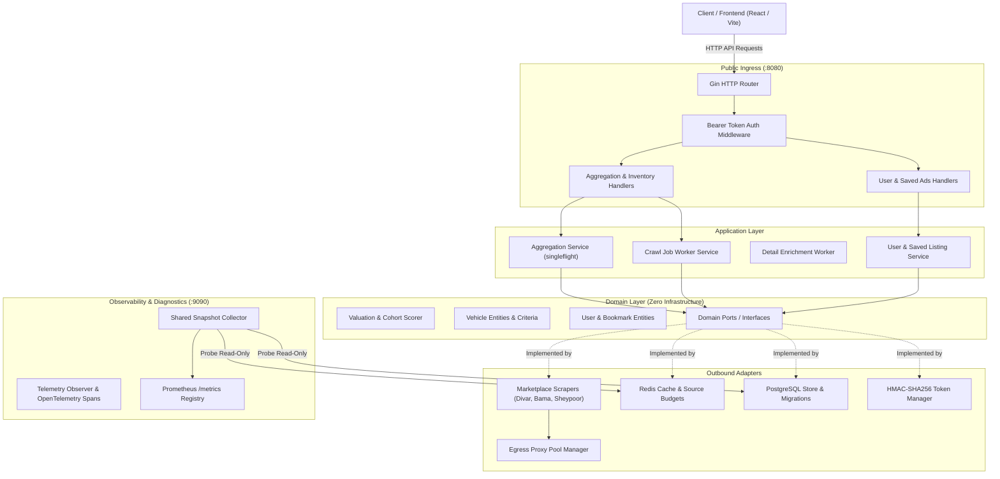
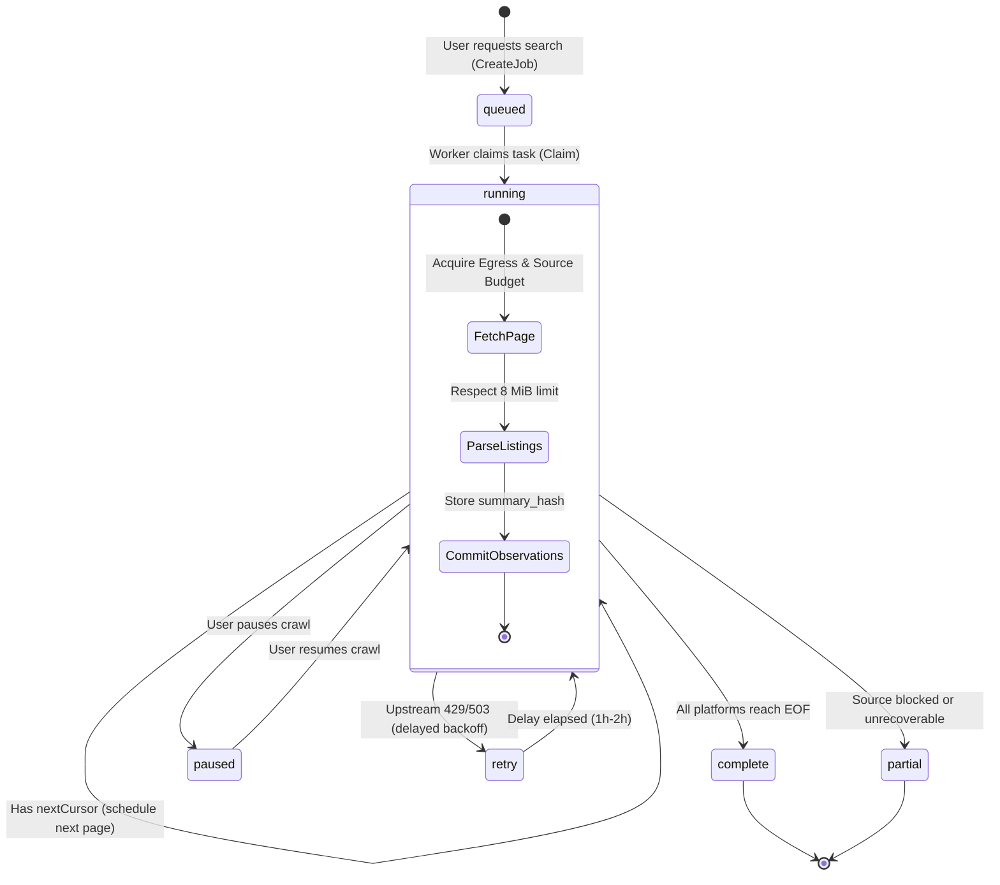

# Jamshid Backend Engineering Onboarding Guide

Welcome to the Jamshid backend engineering team. This guide covers the system architecture, domain models, crawl workflows, persistence, observability infrastructure, and operational practices.

---

## 1. System Overview

Jamshid is an Iranian vehicle-listing aggregator and valuation platform that indexes, normalizes, deduplicates, and scores car and motorcycle listings from **Divar**, **Bama**, and **Sheypoor**.

### Core Architecture Invariants
1. **Never manufacture synthetic data:** If an upstream marketplace scraper fails or blocks, the system explicitly reports partial or unavailable status—it never serves fabricated fallback listings.
2. **Public-by-default access:** Visitors can search, compare, and filter listings without authentication. Authentication is strictly required for personalized features (such as saving ads for future tracking).
3. **Persian & Solar Hijri First-Class Support:** All vehicle titles, city names, and attributes are normalized with Persian character standardizations, Zero-Width Non-Joiner (ZWNJ) preservation, Shamsi vehicle production years (e.g. 1398–1403), and Toman currency units.
4. **Hexagonal Architecture (Ports & Adapters):** Core domain rules (valuation, normalization, vehicle criteria) are completely decoupled from HTTP frameworks (Gin), databases (PostgreSQL/pgx), caches (Redis), and scrapers.

---

## 2. High-Level System Architecture



---

## 3. Package Structure & Hexagonal Boundaries

The backend follows clean hexagonal layering under `backend/`:

```
backend/
├── cmd/
│   └── api/
│       ├── main.go            # Application wiring, server bootstrap, and graceful shutdown
│       └── snapshot.go         # Dedicated read-only monitoring snapshot collector
├── internal/
│   ├── domain/                # Pure business logic (NO database or web framework imports)
│   │   ├── vehicle/           # Vehicle entities, cohort matching, piecewise utility scoring
│   │   ├── user/              # User entity, password/identifier validators, bookmarks
│   │   └── ports/             # Inbound and outbound contracts (Interfaces)
│   ├── application/           # Coordination of workflows and transactions
│   │   ├── aggregation/       # Singleflight live aggregation from multiple marketplaces
│   │   ├── crawljobs/         # Durable background crawl jobs, task leases, and workers
│   │   ├── sourcecheck/       # Marketplace probe runner for drift and degradation
│   │   └── user/              # User registration, login, token issue, saved ad sync
│   └── adapters/              # Edge implementations of ports
│       ├── inbound/
│       │   └── http/          # Gin router, handlers, DTOs, and auth middleware
│       └── outbound/
│           ├── memory/        # Thread-safe in-memory cache and user store for local testing
│           ├── postgres/      # pgx pool, SQL migrations 001-007, queue leases, listings
│           ├── rediscache/    # Distributed Redis cache, rate budgets, cursor signing
│           ├── scrapers/      # Divar, Bama, Sheypoor clients, HTML/JSON parsing
│           ├── telemetry/     # Prometheus histograms, OTel tracer, structured logs
│           └── tokens/        # HMAC-SHA256 signed bearer tokens
```

---

## 4. Crawl Jobs & Worker State Machine

For background and recurring crawls, work is coordinated via PostgreSQL advisory locks and distributed task leases:



### Detail Enrichment Lifecycle
1. Listings discovered on page crawls receive a `summary_hash`.
2. New or changed listings enter `detail_tasks` for deep attribute extraction (e.g., trim, gearbox, chassis condition).
3. If an upstream listing later returns 404/410, its `availability` transition flips from `active` to `unavailable`, ensuring stale listings are automatically hidden from search results.

---

## 5. Valuation & Scoring Engine

Jamshid calculates a composite deal score (0 to 100) using four configurable weights:

$$\text{Score} = w_{\text{price}} \cdot S_{\text{price}} + w_{\text{condition}} \cdot S_{\text{condition}} + w_{\text{mileage}} \cdot S_{\text{mileage}} + w_{\text{year}} \cdot S_{\text{year}}$$

Default weights: **Price: 40%**, **Condition: 30%**, **Mileage: 20%**, **Year: 10%**.

### Cohort Benchmarking
- **Local vs. National Cohort:** Listings are first compared against vehicles of the same model and year range within the selected city. If fewer than 3 local comparables exist, the engine falls back to a national cohort with a confidence penalty.
- **Asymmetric Price Curve:** Deals below cohort median gain up to 35 extra points; prices above median lose points exponentially.
- **Trimmed Median:** The engine filters out outliers outside $0.5 \times \text{mean}$ to $1.5 \times \text{mean}$ before computing the benchmark median.

---

## 6. Observability & Telemetry Architecture

The system follows a strict two-port separation:
- **Port 8080:** Public REST API (monitored and normalized by Gin route templates).
- **Port 9090:** Internal Prometheus metrics and health listener (`127.0.0.1:9090`).

```mermaid
flowchart LR
    subgraph API_Process ["API Process (:8080 & :9090)"]
        HTTPHandler["API Requests (:8080)"]
        TelemetryMiddle["Telemetry Middleware"]
        MetricRegistry["Prometheus Registry (:9090/metrics)"]
        SnapshotCol["Shared Snapshot Collector"]
    end
    
    subgraph Worker_Process ["Worker Process"]
        WorkerLoops["Page & Detail Worker Loops"]
        Heartbeats["Worker Heartbeat Ticks"]
    end
    
    subgraph Storage ["Infrastructure"]
        PG[("PostgreSQL")]
        Redis[("Redis")]
    end
    
    HTTPHandler --> TelemetryMiddle
    TelemetryMiddle --> MetricRegistry
    SnapshotCol -->|Probe (15s interval)| PG
    SnapshotCol -->|Probe (15s interval)| Redis
    SnapshotCol --> MetricRegistry
    
    WorkerLoops --> Heartbeats
    Heartbeats --> MetricRegistry
```

### Key Metrics & Alerts

| Metric Name | Type | Purpose | Alert Trigger |
|---|---|---|---|
| `jamshid_operation_duration_seconds` | Histogram | Latency by operation (`source`, `fetch`, `parse`, `score`) | $p95 > 12\text{s}$ on source fetch |
| `jamshid_worker_task_attempts_total` | Counter | Worker attempt outcomes (`success`, `lease_lost`, `source_failure`) | Sustained `source_failure` rate $> 20\%$ |
| `jamshid_postgres_up` | Gauge (0/1) | PostgreSQL probe connectivity | `0` for $> 30\text{s}$ |
| `jamshid_redis_up` | Gauge (0/1) | Redis probe connectivity | `0` for $> 30\text{s}$ |
| `jamshid_monitoring_snapshot_success`| Gauge (0/1) | Status of shared snapshot collection | `0` (indicates stale metrics) |
| `jamshid_inventory_cache_writes_total`| Counter | Redis `SET` outcomes (`ok` vs `error`) | `error` rate $> 0$ (e.g. OOM / noeviction) |

---

## 7. Developer Workflow & Runbook

### Prerequisites
- Go 1.24+
- Docker and Docker Compose
- PostgreSQL 16+ (optional for local in-memory runs)
- Redis 7+ (optional for local in-memory runs)

### Common Commands
From repository root (`Jame-Jamshid/backend`):
```bash
# Build the binary
make build

# Run unit and race tests
make test

# Start the server locally on :8080
make run
```

### Testing Strategy
- Tests sit alongside source code (`*_test.go`).
- Always run `-race` detection for concurrency safety:
  ```bash
  go test -v -race ./...
  ```
- Memory adapters (`memory.NewCache`, `memory.NewUserStore`) allow all service tests to execute without external infrastructure dependencies.
